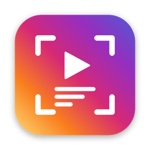

<h1 align="center">ReelScope</h1>

<b>Modela cualquier reel viral y conviértelo en el tuyo.</b> 
Pega el link de un reel: ReelScope desmonta su estructura, te propone 3 hooks y escribe un guion listo para grabar, adaptado a tu negocio.

  <a href="https://github.com/altaventasllc-source/reelscope-app/releases/latest/download/ReelScope.dmg"><b>⬇️ Descargar para Mac</b></a> ·
  <a href="https://altaventasllc-source.github.io/reelscope-app/">Web</a> ·
  Windows: próximamente

## Instalación
1. Descarga **ReelScope.dmg** y ábrelo.
2. Arrastra **ReelScope** a **Aplicaciones**.
3. La primera vez, ábrela con **clic derecho → Abrir → Abrir**. Si macOS no te deja: *Ajustes del Sistema → Privacidad y seguridad → Abrir igualmente*.
4. ReelScope instala lo que falte y te pide iniciar sesión en Claude una vez.

**Requisitos:** macOS 12 o superior (Apple Silicon o Intel) · cuenta de Claude Pro o Max · sesión iniciada en Instagram en tu navegador.

---
Creado por [Ismael Soltero](https://www.instagram.com/ismaelsoltero/)
